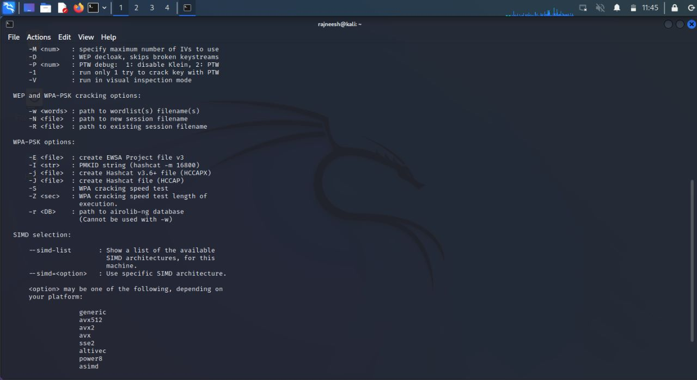
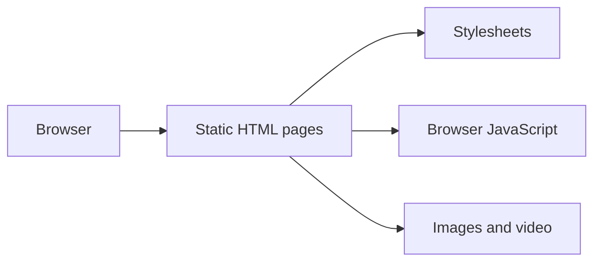

# JaalNetra / HashItOut

A static HTML, CSS, and JavaScript project website with home, demo, download, documentation, help, and contact pages. Its branding refers to network analysis; the repository does not contain a working packet-capture backend.

## Setup

No package installation is required. From the repository root:

```sh
python3 -m http.server 8000
```

Open `http://localhost:8000/home.html`. The root `index.html` redirects to `home.html`; both entry URLs work.

## Structure

- `home.html`: landing page.
- `demo.html`, `download.html`, `documentation.html`, `help.html`, `ContactUs.html`: supporting pages.
- `components/`: images, existing screenshots, and video assets.

## Screenshot



## Architecture



## Known limitations

References to absent scripts/styles have been removed. The demo displays project screenshots, and the download page states that no APK is available. The current tree has no packet-capture service. The old README pointed to another account’s Pages site; that site responding does not prove it deploys this repository. This project has multiple contributors; preserve their credit.

## License

No repository-wide license was detected. No new license has been assigned; the owner must choose appropriate terms and verify rights to included material.

## Checks

```sh
python3 -m unittest discover -s tests -v
```

The checks cover local links/assets, non-empty media/script sources, and the root entry page. They do not validate external sites or a packet-capture service.
